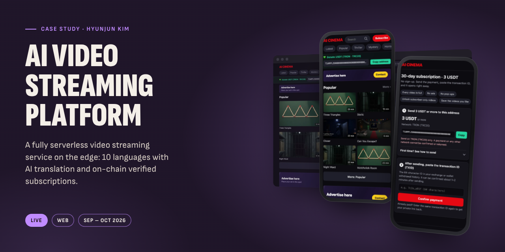
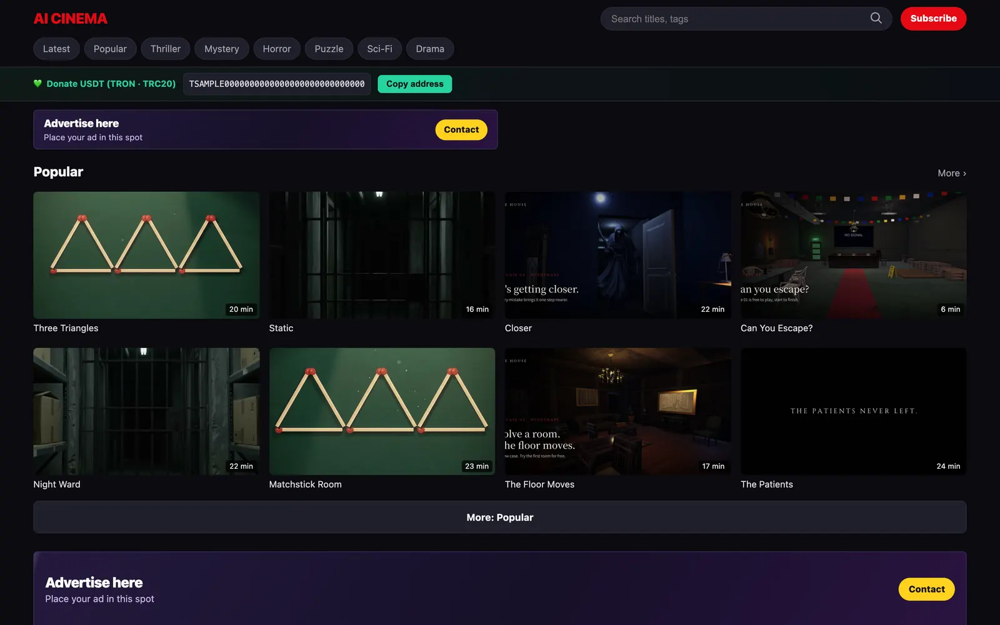
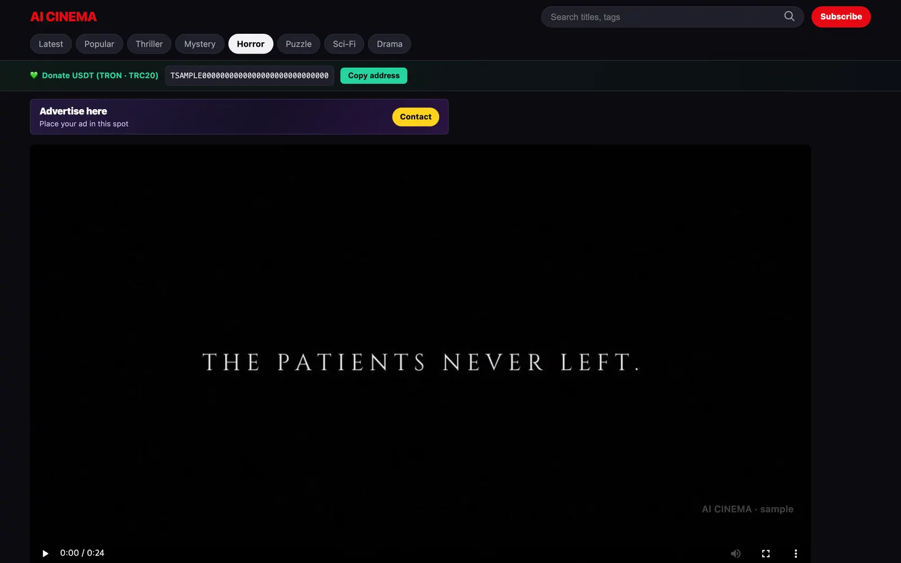
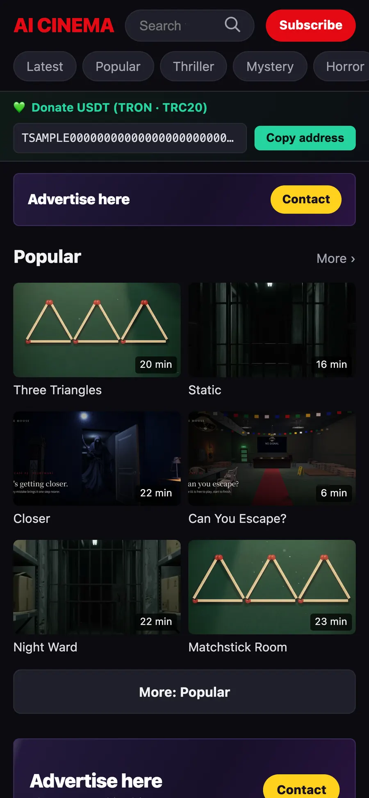
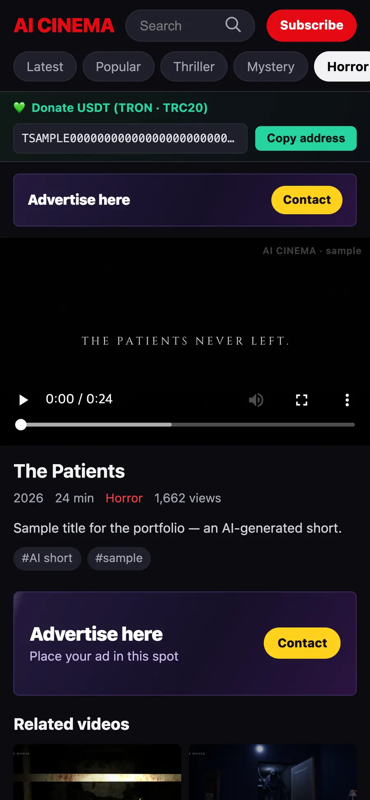
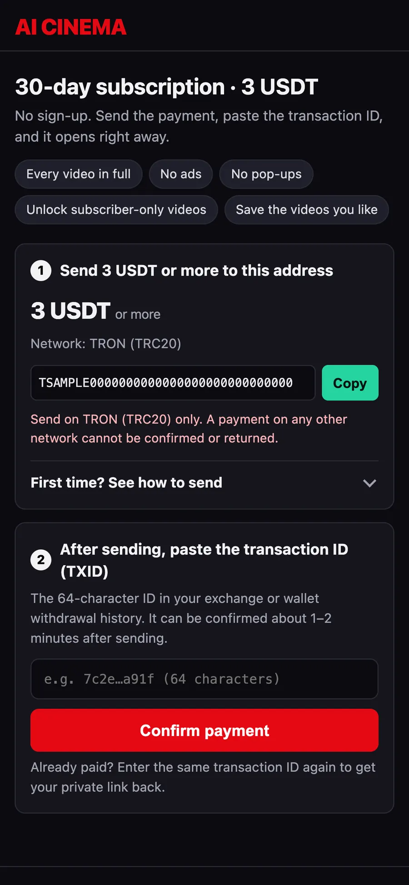
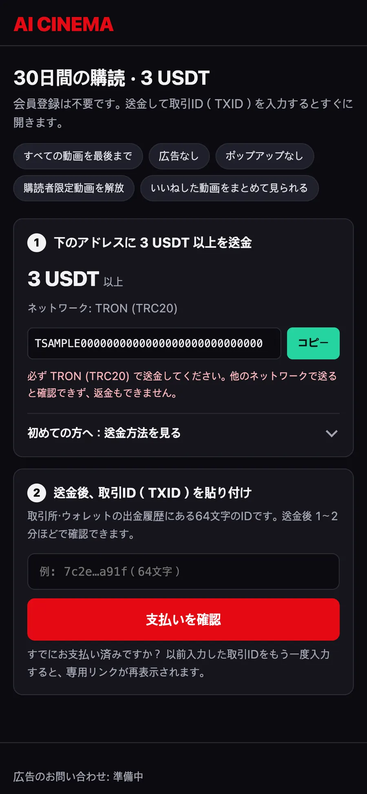
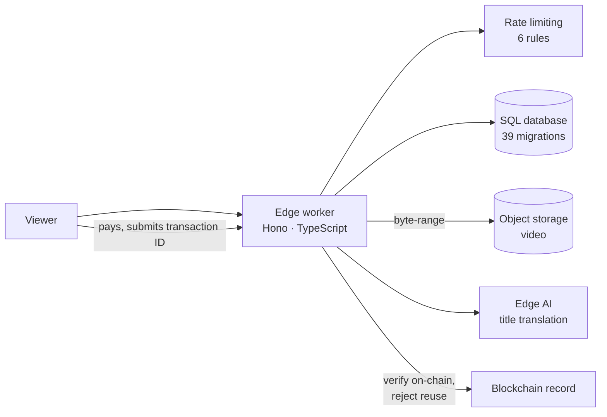

# AI Video Streaming Platform

A fully serverless video streaming service on the edge: 10 languages with AI translation and on-chain verified subscriptions.

**Status:** Live &nbsp;·&nbsp; **Platforms:** Web &nbsp;·&nbsp; **Built:** Sep – Oct 2026
 [Full case study](https://hyunjunkim.vercel.app/projects/video-streaming/)

> [!NOTE]
> This repository is a **case study**, not the source code. The code is private. I'm happy to walk through the codebase live in an interview, or to give a hiring team temporary read access on request.

## The problem

Can one person run a global video service (fast playback, paid subscriptions, many languages) without operating a single server? Everything runs on the edge, so there is nothing to patch, scale or keep alive.

## Screens

> The live address and real content are private on purpose. The screens show the real UI running locally with sample data and a sample site name.

|   |   |
|:-:|:-:|
|  |  |
| Home (desktop) | Player (desktop) |

|   |   |   |   |
|:-:|:-:|:-:|:-:|
|  |  |  |  |
| Home (mobile) | Player (mobile) | Subscription | Subscription in Japanese |

## Architecture

## Key decisions

- **No servers at all.** Compute, database, media storage, rate limiting and AI translation all run on Cloudflare's edge.
- **Payments are verified, not trusted.** A subscription turns on only after the payment is confirmed against the blockchain record, and a transaction can't be reused. Payment-provider webhooks are signature-checked.
- **Every query parameterized.** All 217 SQL queries use parameters, admin sessions are signed with strict cookies, and logins lock out after repeated failures.
- **One-command deploy.** A single idempotent script creates storage, runs migrations, deploys and sets secrets.

## By the numbers

| | |
|--:|:--|
| **0** | Servers to manage |
| **10** | Languages, titles translated by AI |
| **39** | Database migrations |
| **~70** | Versions in about three weeks |

## Problems solved along the way

**Fast playback without an origin server.** Video is served with byte-range requests straight from object storage, with edge caching in front.

**Every viewer in their own language.** UI text comes from 10-language dictionaries, and video titles are translated automatically by an AI model at the edge.

## What's next

- Private Git repository and tests for payment verification, with CI running the existing type check.
- Split the few large route files by domain.
- Error tracking, scheduled database backups and a rollback step in the deploy script.

## Stack

`Cloudflare Workers` · `Hono` · `D1` · `R2` · `Workers AI` · `Workers Rate Limiting` · `TypeScript` · `hls.js` · `Wrangler`

## How it was built

I built this solo, with AI coding agents as my development team. I planned the service and its payment rules, directed the AI agents area by area (delivery, payments, localization, security), and kept a written record of what changed in every version and why.

More of my work: [portfolio](https://hyunjunkim.vercel.app) · [all case studies](https://github.com/g326555-lab)

---

© 2026 Hyunjun Kim. All rights reserved. See [LICENSE](LICENSE).
